# Ludo Crown

A polished, social Ludo game for iPhone, built with **.NET MAUI (C#)**, an **authoritative ASP.NET Core + SignalR game server**, and **PostgreSQL**.

- Two game modes: **Classic** (all 4 pieces home) and **Quick** (first piece home wins), online and offline
- Online matchmaking (2 or 4 players) in **ranked** (league) and **casual** queues, with bots filling empty seats after a short wait
- **Gem rerolls** (7 per Classic match, 5 per Quick), validated and charged by the server
- **Store:** gold, gems, Shield bottles and cosmetic frames. Apple in-app purchases are verified by the server, and a development sandbox lets you test without Apple.
- **Shield bottle** boost, in casual matches and private tables only
- **Quick chat** with preset phrases and emoji, plus mute, block and an off switch
- **League:** 14-day seasons, six original divisions (Squire to Monarch), groups, promotion and demotion, fixed season rewards
- **Public player profiles** with Classic and Quick stats, plus privacy settings
- Private tables with a 6-character code or a `ludocrown://join/CODE` invite link, plus rematch
- Offline play against Easy / Normal / Hard computer opponents, or pass-and-play on one phone; saved games resume automatically
- Sign in with Apple, Google, Facebook, or passwordless email, plus a guest mode you can upgrade later
- Profiles, avatars, levels, statistics, match history, friends (by friend code), blocking and reporting
- Account deletion and a data download built into the app

> **Try it in your browser:** <https://mustafa-v12.github.io/LudoCrown/> — the web version (offline vs computer or pass-and-play, same rules engine). Works on iPhone without installing anything; see [web/README.md](web/README.md).

> **Status at a glance:** see [HANDOFF.md](HANDOFF.md) for exactly what is implemented, what was verified (and how), and what still needs your accounts, credentials or a Mac.

## Web version (play in Safari)

<https://mustafa-v12.github.io/LudoCrown/> — offline against the computer or pass-and-play, Classic and Quick, same rules engine as the app.

| | | | |
|---|---|---|---|
| 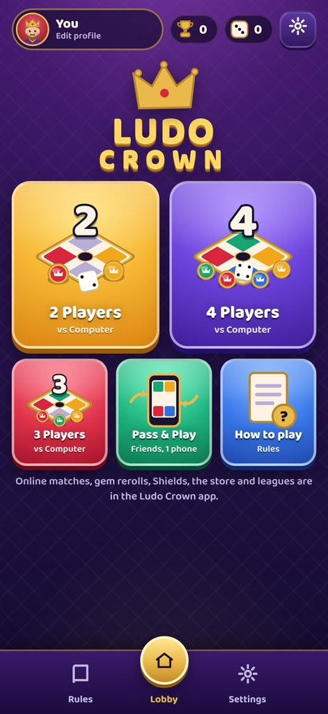 | 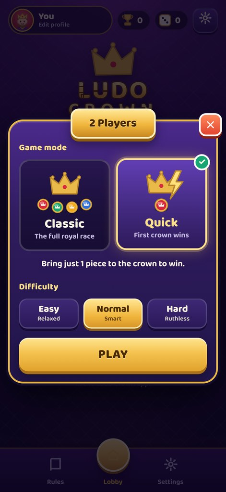 | 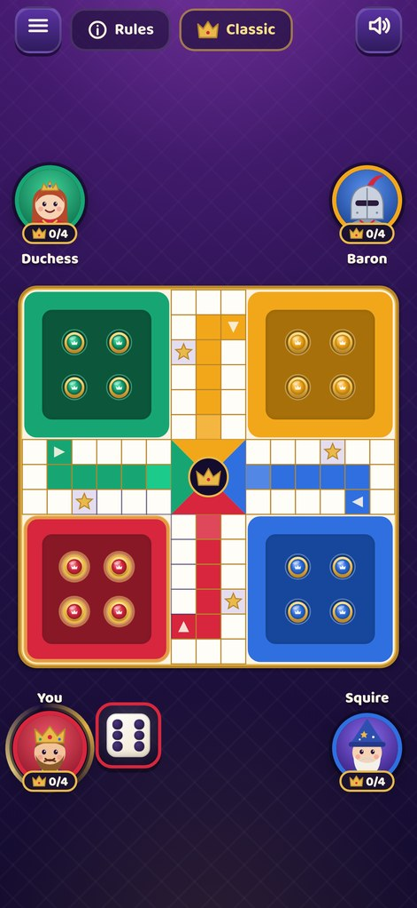 | 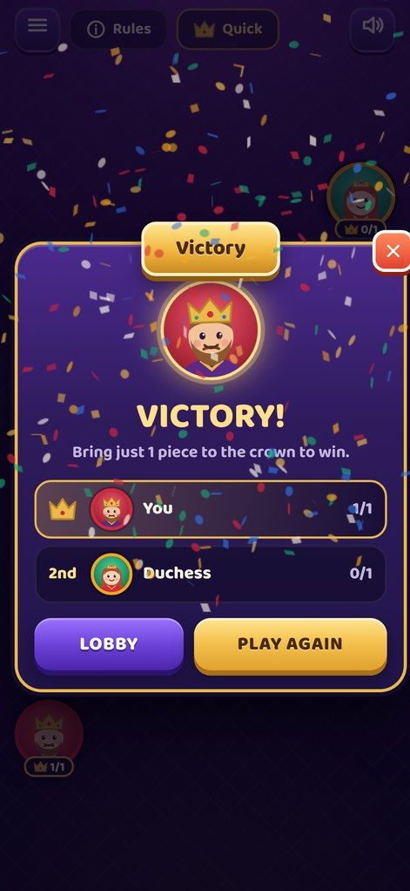 |

## Screenshots

Taken from the Windows build running against the local development server. The iPhone build uses the same screens.

| | |
|---|---|
| 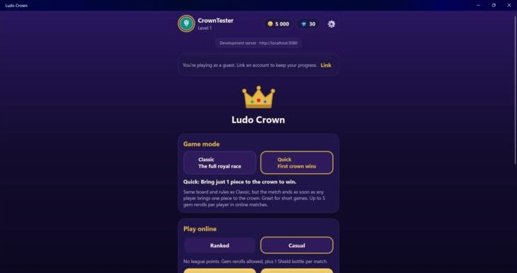 | 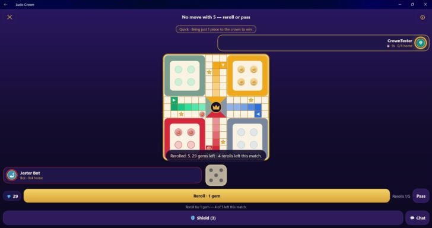 |
| **Home:** choose Classic or Quick, ranked or casual | **Gem reroll:** reroll or pass, with the remaining rerolls shown |
| 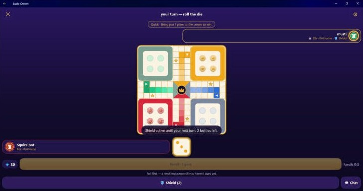 | 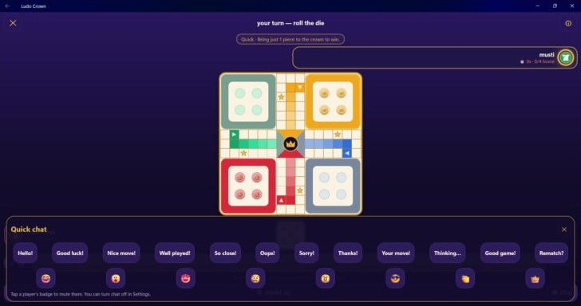 |
| **Shield bottle** (casual only), visible to every player | **Quick chat:** preset phrases and emoji |
| 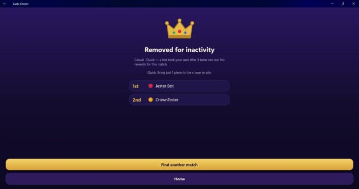 | 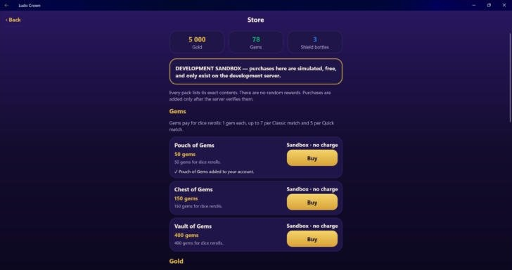 |
| **Results** | **Store** (development sandbox, no real purchases) |
| 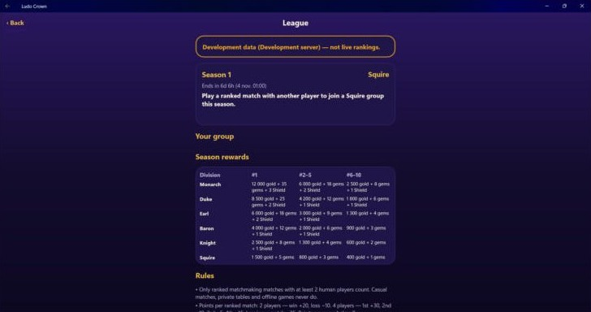 | 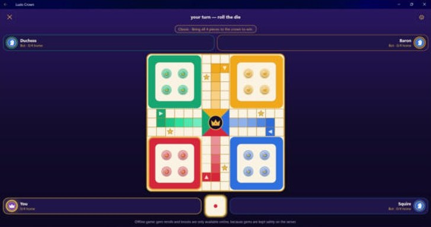 |
| **League:** season, group and reward table (development data) | **Offline** Classic game against computer opponents |


## Working together

- `main` should always build and pass the tests. Do new work on a branch (`git switch -c feature/my-change`), push it, and open a pull request on GitHub so the other person can review it.
- Before you push, run the tests: `dotnet test` (or `tools\windows\build-and-test.cmd` on Windows).
- Never commit secrets: real keys, passwords, `.p8`/`.p12` files, or `appsettings.*.local.json`. They are already listed in `.gitignore`. Use environment variables or user secrets as described below.
- Rules for gameplay, the store and the league live in `docs/`. Update them in the same pull request when you change behaviour.

---

## Repository layout

```
LudoCrown.sln
src/
  LudoCrown.Core/            Rules engine, board geometry, AI bots, dice, online protocol (no dependencies)
  LudoCrown.App.Logic/       App view models, offline/online game sessions, auth session, API client (no MAUI)
  LudoCrown.Mobile/          .NET MAUI app: XAML screens, board renderer, iOS/Android/Windows platform code, assets
  LudoCrown.Server/          ASP.NET Core server: auth, REST API, SignalR hub, matches, matchmaking, private rooms
  LudoCrown.Server.Data/     Persistence contracts + in-memory development store
  LudoCrown.Server.Postgres/ PostgreSQL store (Npgsql), migration runner, maintenance job
web/                         Browser version (TypeScript + Vite), published to GitHub Pages
tests/
  LudoCrown.Core.Tests/      Rules, geometry, AI, protocol, saved-game validation
  LudoCrown.Server.Tests/    Anti-cheat, timers, reconnection, matchmaking, rooms, tokens, ID tokens, email codes
  LudoCrown.App.Tests/       Offline/online sessions, auth session + token refresh, screen view models
  LudoCrown.Postgres.Tests/  PostgresStore against a real database (opt-in, see below)
db/
  migrations/                Versioned SQL migrations (embedded into the server)
  roles.sql                  Least-privilege database roles
deploy/                      Dockerfile, docker-compose (server + PostgreSQL), .env.example
docs/                        Rules, architecture, backend, database, auth setup, privacy, release checklist
tools/                       Dev-only verification tools (see "Development tools")
```

Read more: [Architecture](docs/ARCHITECTURE.md) · [Rules](docs/RULES.md) · [Backend & deployment](docs/BACKEND.md) · [Database](docs/DATABASE.md) · [Auth setup](docs/AUTH_SETUP.md) · [Privacy](docs/PRIVACY.md) · [Release checklist](docs/RELEASE_CHECKLIST.md) · [Decisions](docs/DECISIONS.md)

---

## Prerequisites

| For | You need |
|---|---|
| Server, libraries, tests | [.NET 10 SDK](https://dotnet.microsoft.com/download) |
| The app in Visual Studio (Windows) | Visual Studio 2026 (or 2022 17.14+) with the **.NET Multi-platform App UI development** workload |
| iOS builds and the iOS Simulator | A Mac with Xcode, paired from Visual Studio (**Tools → iOS → Pair to Mac**), or a cloud macOS build service |
| Running on your own iPhone | Apple Developer Program membership ($99/year), Xcode signing on the paired Mac |
| Database | PostgreSQL 15+ (local install, Docker, or a managed service) |

Install the MAUI workload from a terminal if you prefer: `dotnet workload install maui`.

---

## Quick start (Windows + Visual Studio)

### 1. Run the server

You can run the server without a database. It then uses the in-memory development store, and data resets on restart.

1. Open `LudoCrown.sln`.
2. Right-click **LudoCrown.Server** → **Set as Startup Project** → press **F5**.
3. Check that <http://localhost:5080/health> says `Healthy`.

In Development the server:
- writes email sign-in codes to the console,
- uses a random signing key per run, so tokens stop working after a restart; sign in again,
- fills matchmaking with bots after 10 seconds.

### 2. Run the app on Windows (fastest way to try it without a Mac)

1. Right-click **LudoCrown.Mobile** → **Set as Startup Project**.
2. Pick the **Windows Machine** target and press **F5**.
3. On the sign-in screen choose **Play as guest**, or **Play offline against the computer**.

> To play online against yourself, start the app twice: one Windows instance and one Android emulator. Or run the scripted smoke-test client (see [Testing](#testing)).

Debug builds connect to `http://localhost:5080` (the Android emulator uses `http://10.0.2.2:5080`). You can change the server URL in **Settings → Development** in Debug builds.

### 3. Run on iOS

1. Pair a Mac: **Tools → iOS → Pair to Mac**.
2. Choose an **iOS Simulator** target and press **F5**.
3. For a physical iPhone, the server must be reachable from the phone. Use a Visual Studio **Dev Tunnel** (HTTPS), or deploy the server, then set its URL in **Settings → Development**.

Sign in with Apple only works once the capability is enabled. See [docs/AUTH_SETUP.md](docs/AUTH_SETUP.md).

### Local development environment (client + server + PostgreSQL)

The three run modes are kept clearly apart. The app shows which one you're in: a line under the home screen title, and Settings → Development.

| Mode | What runs | Data |
|---|---|---|
| **Offline** | Only the app. Bots and pass-and-play on this device. | Saved on the device. No gems, rerolls, boosts or league. |
| **Local development** | The app (Debug) plus the server in Development, optionally with your local PostgreSQL | Dev tools are on: test gold/gems/Shields in Settings → Development, the store sandbox, and ending a league season early. Labelled "Development". |
| **Production** | A Release app plus your deployed server | Real accounts, real purchases. Dev tools don't exist there. |

- If the server or database can't be reached, the app says so ("Couldn't reach the server…"). It **never** silently switches online play to a local or fake match. Offline play is always a separate, explicit choice.
- A typical local setup: start PostgreSQL (Docker or your own install, below), run **LudoCrown.Server** (F5), then run **LudoCrown.Mobile** on Windows Machine.
  - Sign in as a guest, then use Settings → Development → *Add test gold, gems & Shields*.
  - Play a ranked or casual match against the bots, try the store sandbox, and open the league.
- An automated end-to-end check is in `tools/smoke`: `npm install`, then `node smoke.mjs http://localhost:5080`.

### Windows without Visual Studio (scripts in `tools/windows`)

Double-click these in File Explorer. Each one writes a log next to itself.

| Script | What it does |
|---|---|
| `install-sdk.cmd` | Installs the .NET 10 SDK (winget) and the MAUI Windows workload. Asks for administrator rights. Run once. |
| `build-and-test.cmd` | Runs all four test projects, then builds the server and the Windows app. Log: `build-log.txt` |
| `run-dev.cmd` | Builds the Windows app, (re)starts the development server on <http://localhost:5080> (in-memory data), and starts the app. Logs: `run-log.txt`, `server-log.txt`, `app-log.txt` (navigation and errors) |

To build only the Windows app (no iOS or Android workloads needed): `dotnet build src/LudoCrown.Mobile -p:LudoWindowsOnly=true -f net10.0-windows10.0.19041.0`. Windows builds run unpackaged, so `bin\Debug\net10.0-windows10.0.19041.0\win-x64\LudoCrown.Mobile.exe` starts directly.

### Use PostgreSQL locally

**With Docker:**

```bash
cp deploy/.env.example deploy/.env      # set a password and a JWT key
docker compose -f deploy/docker-compose.yml --env-file deploy/.env up --build
```

**With your own PostgreSQL:**

1. Create a database.
2. Set the connection string with user secrets (never in `appsettings.json`):

   ```bash
   cd src/LudoCrown.Server
   dotnet user-secrets set "ConnectionStrings:Postgres" "Host=localhost;Database=ludocrown;Username=...;Password=..."
   dotnet user-secrets set "Jwt:SigningKey" "<base64 32 bytes>"
   ```

In Development the server applies migrations at startup. In other environments, set `Database__MigrateOnStartup=true` or apply `db/migrations/*.sql` yourself (see [docs/DATABASE.md](docs/DATABASE.md)).

---

## Configuration

Server settings live in `src/LudoCrown.Server/appsettings.json`, which contains placeholders only. Override them with environment variables, using `__` for nesting (for example `Jwt__SigningKey`), or with user secrets in development.

| Setting | Purpose |
|---|---|
| `ConnectionStrings:Postgres` | PostgreSQL connection. **Required outside Development**: the server refuses to start without it. |
| `Jwt:SigningKey` | Base64 key of at least 32 bytes for access tokens. **Required outside Development.** |
| `Auth:PublicBaseUrl` | The server's public HTTPS URL, used for Google and Facebook OAuth redirects |
| `Auth:Apple:*`, `Auth:Google:*`, `Auth:Facebook:*`, `Auth:Email:*` | Sign-in providers. Each provider is enabled only when it is configured; the app hides buttons for disabled providers. |
| `Match:*` | Turn timer (20 s), disconnect grace period (90 s), missed-turn limit (3), bot fill wait (30 s), held-roll window (10 s), `ChatEnabled` |
| `Store:*` | App Store product ID prefix and App Store Server API keys (see [docs/STORE.md](docs/STORE.md)). `Store:DevSandbox` works in Development only. |
| `League:*` | `Enabled`, `SeasonDays` (see [docs/LEAGUE.md](docs/LEAGUE.md)) |
| `DevTools:AllowGemGrant` | Development only: enables the `/dev/*` endpoints (test currency, ending a season). Ignored in other environments. |
| `Database:MigrateOnStartup`, `Database:MatchRetentionDays` | Migration and retention behaviour |

App settings that you must change before release are marked `TODO before release` in `src/LudoCrown.App.Logic/Services/PlatformServices.cs` (`AppConfig`) and in `src/LudoCrown.Mobile/LudoCrown.Mobile.csproj` (`ApplicationId`).

---

## Testing

**In Visual Studio:** open **Test Explorer** and choose **Run All**. From a terminal:

```bash
dotnet test tests/LudoCrown.Core.Tests
dotnet test tests/LudoCrown.Server.Tests
dotnet test tests/LudoCrown.App.Tests
```

**PostgreSQL integration tests** need a disposable database:

```bash
# PowerShell: $env:LUDOCROWN_TEST_POSTGRES="Host=localhost;Database=ludocrown_test;Username=...;Password=..."
export LUDOCROWN_TEST_POSTGRES="Host=localhost;Database=ludocrown_test;Username=...;Password=..."
dotnet test tests/LudoCrown.Postgres.Tests
```

Without that variable, these tests return immediately and report as passed.

**Validate all SQL against the real schema** (PostgreSQL prepares every statement):

```bash
psql "$DB_URL" -f db/migrations/0001_initial_schema.sql
python3 tools/verify-sql.py "$DB_URL"
```

**End-to-end online smoke test:** two scripted clients sign in as guests, get matched, play a full game over SignalR, and check results, rewards and account deletion against a running server.

```bash
cd tools/smoke && npm install && node smoke.mjs http://localhost:5080
```

Dice and other randomness are injected (`IDiceRoller`, `IDelay`, `TimeProvider`), so tests are deterministic.

---

## Building for release

- **Server:** `docker build -f deploy/Dockerfile -t ludocrown-server .` or `dotnet publish src/LudoCrown.Server -c Release`. Deployment options are in [docs/BACKEND.md](docs/BACKEND.md).
- **iOS app:** on the paired Mac or in a macOS CI job:

  ```bash
  dotnet publish src/LudoCrown.Mobile -f net10.0-ios -c Release -p:ArchiveOnBuild=true -p:EnableAppleSignIn=true
  ```

  Then upload with Transporter or Xcode Organizer. Follow [docs/RELEASE_CHECKLIST.md](docs/RELEASE_CHECKLIST.md).

---

## Development tools (`tools/`)

These tools exist because the environment that generated this project could not reach nuget.org. You don't need them in Visual Studio.

| Tool | What it is |
|---|---|
| `tools/LudoCrown.TestShim` | Runs the xUnit test sources through a tiny xUnit-compatible runner without NuGet |
| `tools/NpgsqlPsqlStub` | Stand-in for the Npgsql API that executes queries through `psql`, used to compile and run the real `PostgresStore` without NuGet. Not for production. |
| `tools/BoardPreview` | Renders the app's real board-drawing code to SVG, for checking visuals without a phone |
| `tools/verify-sql.py` | Prepares every SQL statement against a migrated database |
| `tools/smoke` | Node SignalR client for the end-to-end online test |

---

## Known limitations

- The iOS build, signing, simulator and device runs have **not** been performed. They need a Mac, Xcode and your Apple account. The MAUI project was written for .NET 10 but has not been compiled. Expect to fix small compile issues the first time you build it in Visual Studio.
- Sounds play on iOS only. Android and Windows builds are silent.
- Google and Facebook sign-in use the system browser sheet, which isn't available on Windows desktop builds. Windows shows only guest, email and offline play.
- The server holds live matches in memory on a single instance. Running several instances needs sticky routing plus a SignalR backplane (see [docs/BACKEND.md](docs/BACKEND.md)).
- **In-app purchases have not been tested with Apple.** The products don't exist yet in App Store Connect, product IDs are placeholders, and the StoreKit code has not been compiled. The server flow is tested with fakes and the development sandbox. See [docs/STORE.md](docs/STORE.md).
- No ads, tracking, voice chat or free-text chat.
- Reports from players are stored in the database. There is no moderation dashboard yet; review them with SQL (see [docs/DATABASE.md](docs/DATABASE.md)).
